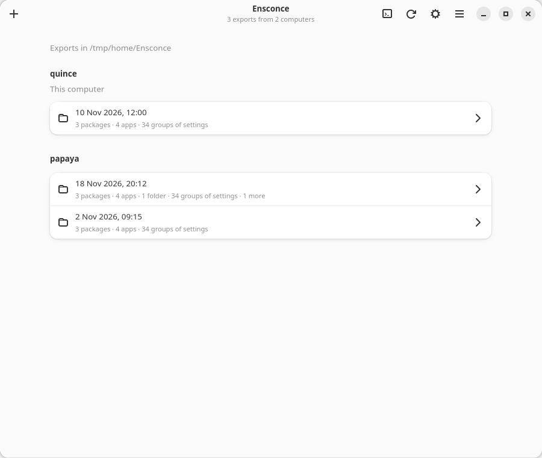

# Ensconce

Ensconce sets up a fresh [Bluefin-DX](https://projectbluefin.io/) installation
the way you want it: layered packages, Flatpaks, GNOME extensions, Nextcloud
folders, desktop and login screen settings, a synced SSH config with Bitwarden
as the agent, kiwi apps, and more. You describe the setup in plain list files,
and each part is applied by its own *step*, a small script in `steps/`.

It can also go the other way. An *export* reads a computer's setup back into
those files, and the Ensconce app keeps exports in one folder. Put that folder
in Nextcloud, and every computer can restore what another one exported.

It is part of the Kiwi desktop: apps for Fedora Atomic that
[kiwi-updater](https://github.com/derlocke-ng/kiwi-updater) installs from git
catalogs.

- Latest release: see [Releases](https://github.com/derlocke-ng/ensconce/releases); it is in the [Kiwi catalog](https://github.com/derlocke-ng/kiwi-catalog)
- Runs on: Bluefin and Bluefin-DX (Universal Blue images)
- License: GPL-3.0-or-later



## Install

```bash
kiwi install ensconce
```

Or from a checkout: `./install.sh install`. It installs for your user only,
into `~/.local`, and never needs root itself. The steps that change the
system ask for your password when they run.

## Quick start

Set up a new computer from the example files:

```bash
ensconce --init          # create ~/.config/ensconce from the examples
ensconce --dry-run       # show what would change
ensconce                 # apply it
```

Or start the app, **Ensconce**, from the app grid (`ensconce-gui`). Export
this computer with the **+** button, choose an exports folder that Nextcloud
syncs in Preferences, and restore that export on your next computer.

## Documentation

| Page | What it covers |
|---|---|
| [Install](docs/install.md) | install, update, uninstall, where files go |
| [The Ensconce app](docs/app.md) | exports folder, export, restore, sharing with your other computers |
| [Using the command](docs/usage.md) | every option, the steps, resuming, `--export` |
| [Configuration](docs/configuration.md) | `settings.sh` and every list file and folder |
| [Development](docs/development.md) | project layout, writing a step, tests, releases |

The same pages are on [kiwi-network.eu](https://kiwi-network.eu/docs/).

## License

GPL-3.0-or-later; see [LICENSE](LICENSE).
