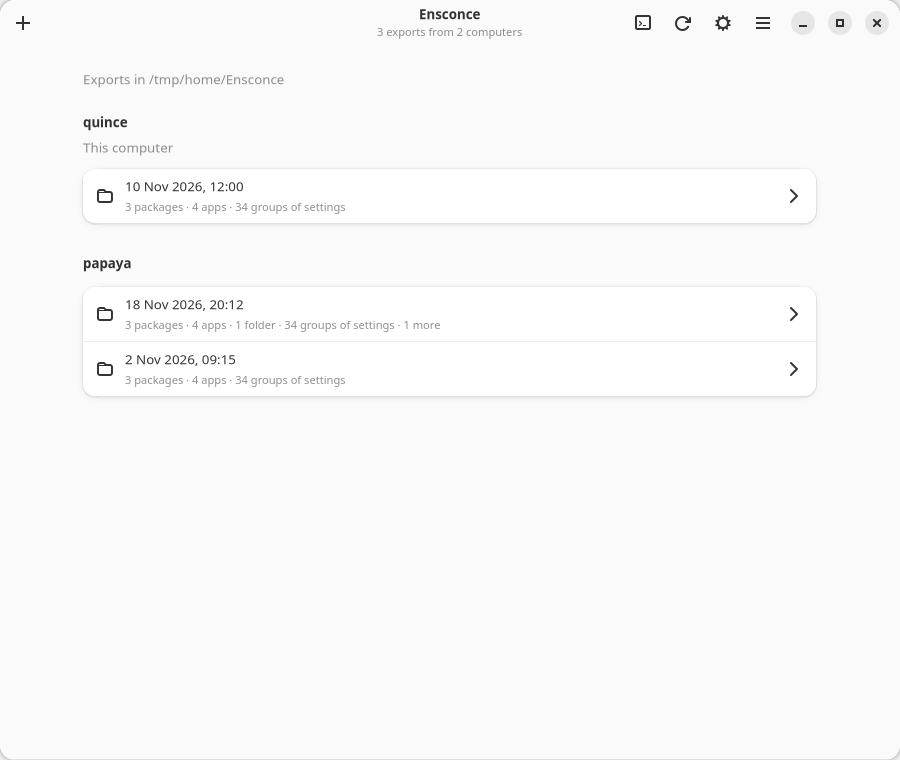
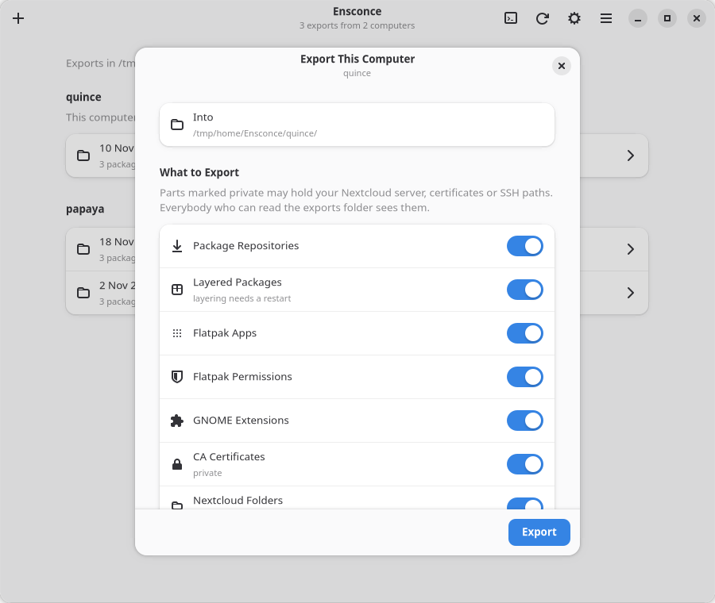
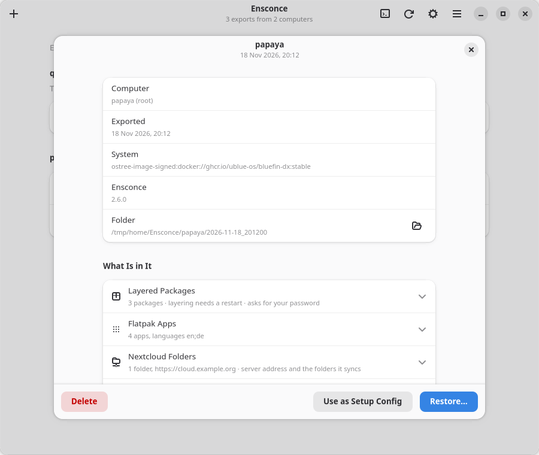
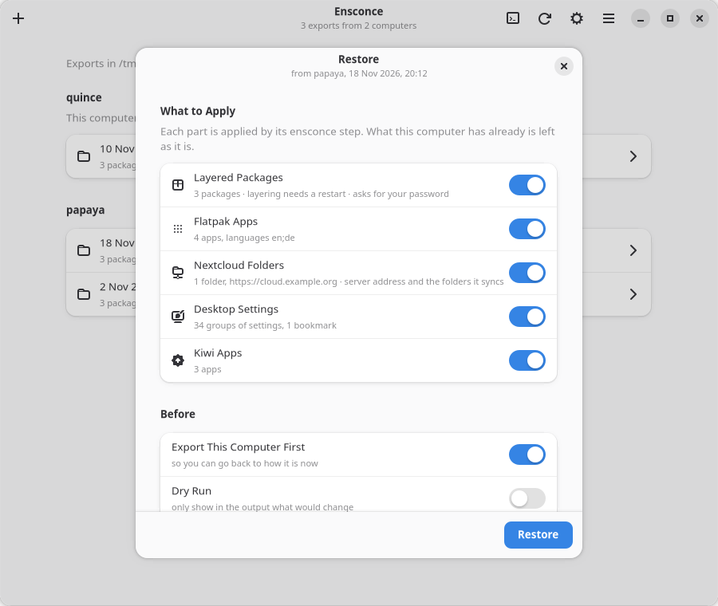

# The Ensconce app

The Ensconce app is a window for two jobs: exporting this computer's setup,
and restoring a setup on this computer. It does both by running the
`ensconce` command, so the app and the command always do the same thing. You
start it from the app grid as **Ensconce**, or with `ensconce-gui`.



## The exports folder

An *export* is a folder with this computer's setup in the files that
ensconce reads: `packages.list`, `flatpaks.list`, `dconf-settings.ini` and
the others ([Configuration](configuration.md) lists them all). The app keeps
every export in one folder, with a subfolder for each computer:

```
~/Ensconce/
├── quince/
│   ├── 2026-11-10_120000/
│   └── 2026-11-20_110505/
└── papaya/
    └── 2026-11-18_201200/
```

The main window lists the exports by computer, newest first, with a short
summary of what each holds. Your own computer's are on top, marked "This
computer".

`~/Ensconce` is the default. To choose another folder, open Preferences (the
gear) and use **Choose…** next to **Exports Folder**.

## Share exports with your other computers

Choose a folder that Nextcloud syncs as the exports folder, for example
`~/Nextcloud/Ensconce`, and do the same on your other computers. Each
computer then writes its exports into a subfolder of its own name and sees
the exports of all the others. The app reads the folder again when you come
back to its window, when a computer's subfolder appears, and when you click
Refresh.

An export is written into a hidden folder first and renamed once it is
complete. Another computer never lists half an export.

**Some parts can be private.** The CA certificates, the Nextcloud folders
(your server's address and the folders it syncs) and the SSH setup are marked
"private" in the export dialog. Everybody who can read the exports folder can
read them. Turn them off if you share the folder with other people.

## Export this computer

Click **+** (Export This Computer). The dialog lists the parts of a setup;
turn off what you do not want in the export, and click **Export**. The app
remembers your choice for the next export. `settings.sh` is always written:
without it an export is not a config ensconce can use.



The job strip at the bottom of the window shows the kiwi while the export
runs. The terminal button in the header bar opens the command's output.

## See what is in an export

Click an export. The dialog shows which computer made it, when, on which
system image and with which version of ensconce. Below that, each part it
holds, with a count. Open a part to see its entries: the packages, the
Flatpak apps, the groups of desktop settings and so on.



From here you can:

- **Restore…**: apply the export to this computer (see below).
- **Use as Setup Config**: make this export the config the `ensconce`
  command uses. Your config as it is now is copied to
  `~/.local/state/ensconce/config-before-<date>` first. The app's own
  settings, which are in the same folder, stay as they are.
- **Delete**: remove the export from the folder. With a shared folder, this
  removes it on every computer that syncs it.

## Restore an export

**Restore…** asks which parts to apply. Each part is applied by its
ensconce step, as `ensconce --only <steps>` would. What the computer has
already is left as it is: an installed Flatpak is not installed again.



- **Export This Computer First** exports this computer before anything
  changes, so you can go back to how it was. It is on unless you turn it off.
- **Dry Run** applies nothing. The output shows what each step would do.

Parts marked "asks for your password" change the system: package
repositories, layered packages, CA certificates, the login screen, kernel
tunables and sleep. The steps run `sudo` for them, and the app shows a
password dialog for sudo. Layered packages need a restart before they are in
use; the output says so. The steps for the desktop (extensions, settings)
may also need you to log out and in again.

## What the app never does

- **It never runs a file from an export.** An export's `settings.sh` is a
  shell script, and the exports folder may come from another computer. The
  app reads it as text and takes over only the settings ensconce knows
  (`NEXTCLOUD_SERVER`, `FLATPAK_LANGUAGES`, `SYSTEM_SLEEP`, `SSH_SYNCED_DIR`,
  `SSH_CONTROL_DIR`, `SSH_AGENT`, `KIWI_INSTALL`). A value that needs the
  shell to work it out, such as `$(…)`, is left out. It writes a new
  `settings.sh` from them, for the restore and for "Use as Setup Config".
- **It never applies anything itself.** Every change is made by an ensconce
  step, which you can read in `steps/`.

The other files of an export are what the steps install, so look at an
export from someone else before you restore it: its packages, repositories
and certificates are installed system-wide.

## Preferences

| Setting | What it does |
|---|---|
| Exports Folder | the folder the app lists and exports into; `~/Ensconce` by default |
| App Icon, Icon Style | the app's icon in the app grid, as in every Kiwi app |
| Size | **Reset** sets the window back to its default size |
| Show Output While Working | open the command's output when a job starts; it opens anyway when a job fails |

The app keeps these in `~/.config/ensconce/settings.json`.
